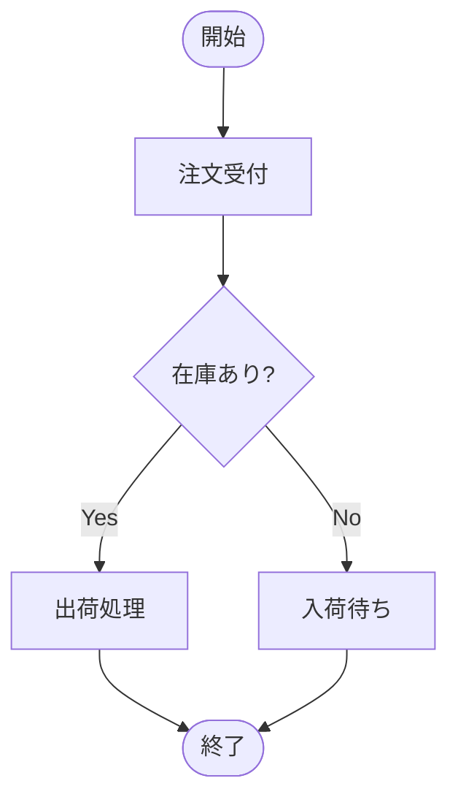
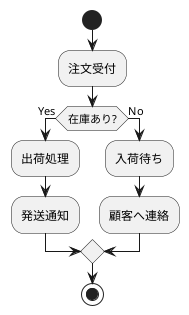
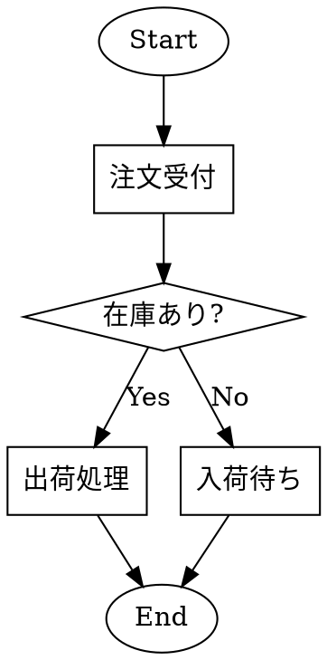

# Diagram Demonstration

---

## mermaid



---

## PlantUML



---

## Graphviz



---

## D2

```d2
start: 開始
order: 注文受付
stock: 在庫あり？
ship: 出荷処理
wait: 入荷待ち
end: 終了

start -> order
order -> stock

stock -> ship: Yes
stock -> wait: No

ship -> end
wait -> end

stock.shape: diamond
```

---
