# mermaid Demonstration

---

## フローチャート

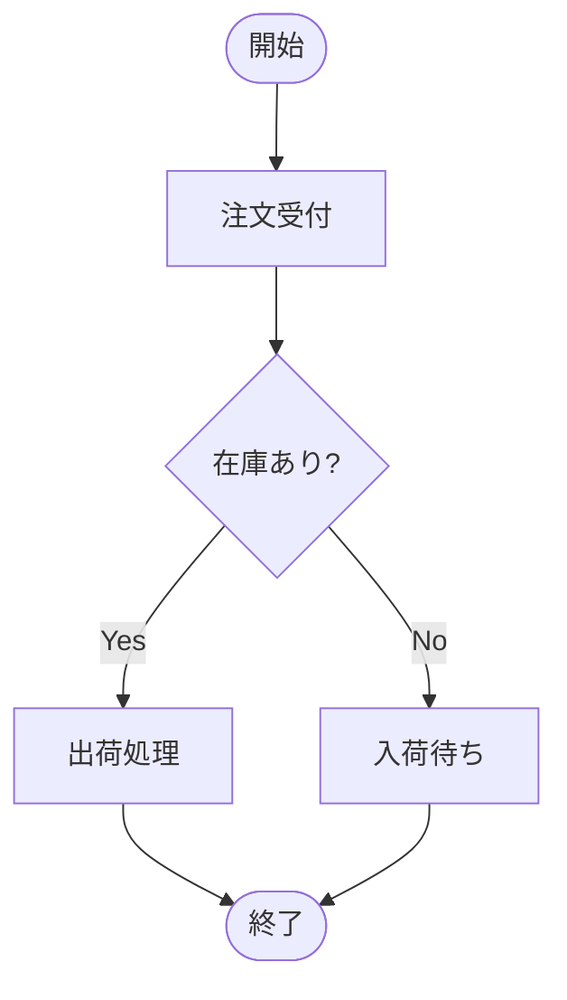

---

## シーケンス図

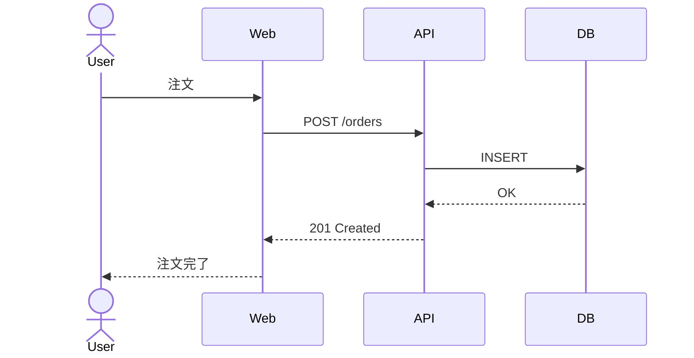

---

## クラス図

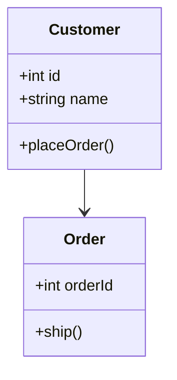

---

## 状態遷移図

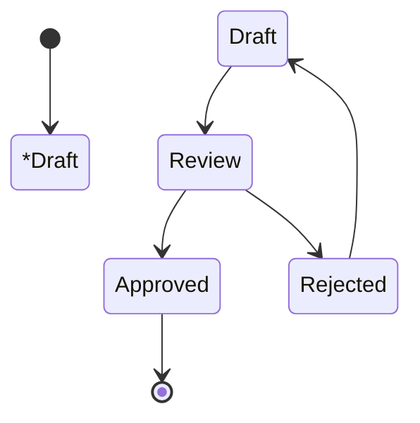

---

## ER図

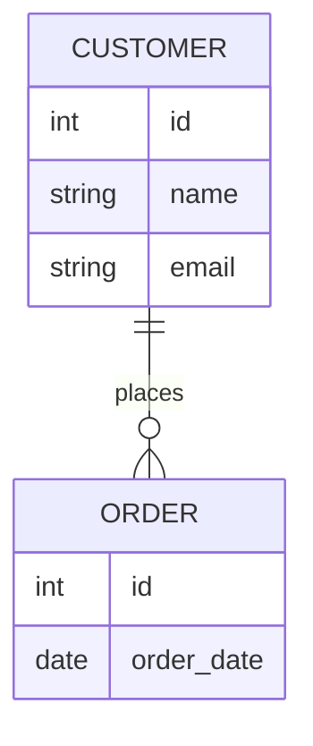

---

## ユースケース図風

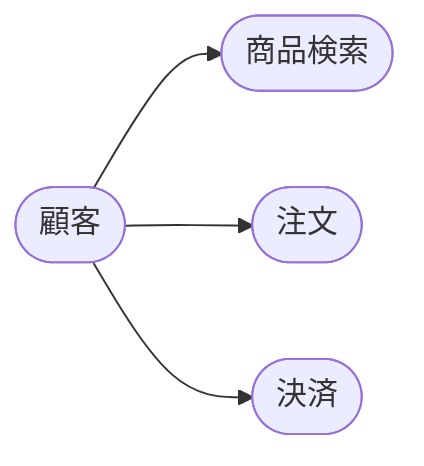

---

## システム構成図

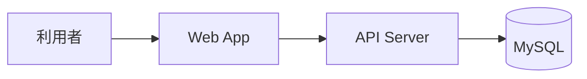

---

## AWS風アーキテクチャ図

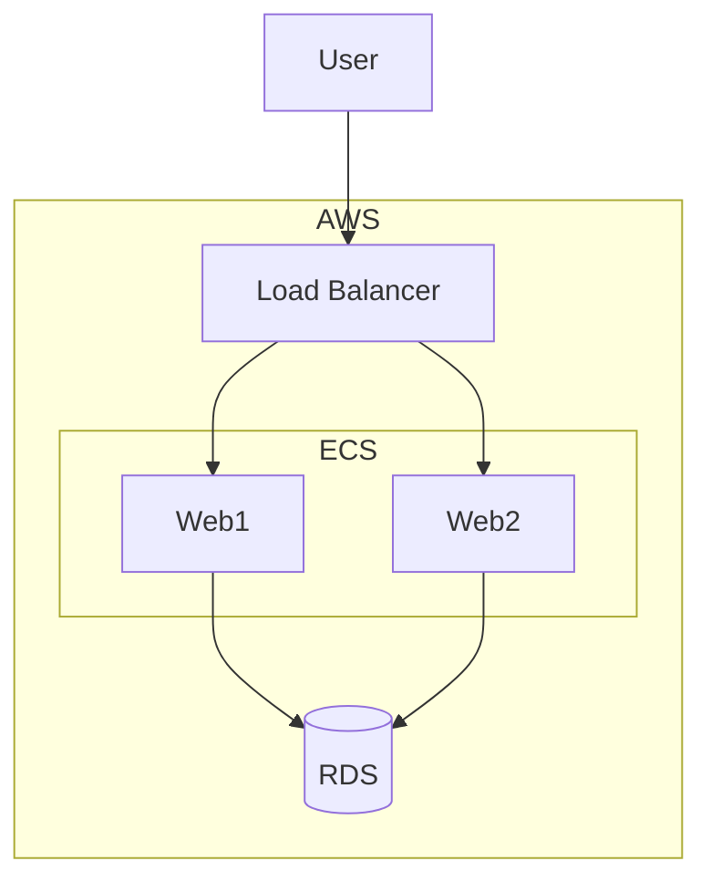

---

## ガントチャート

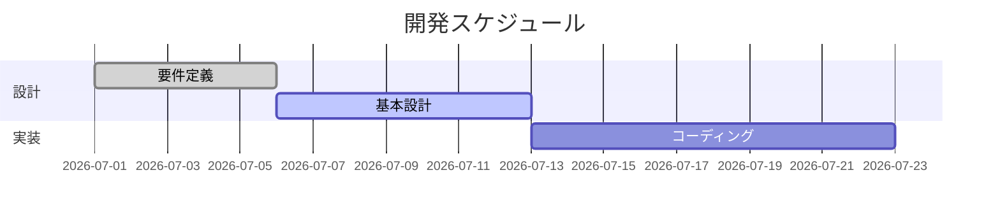

---

## 円グラフ

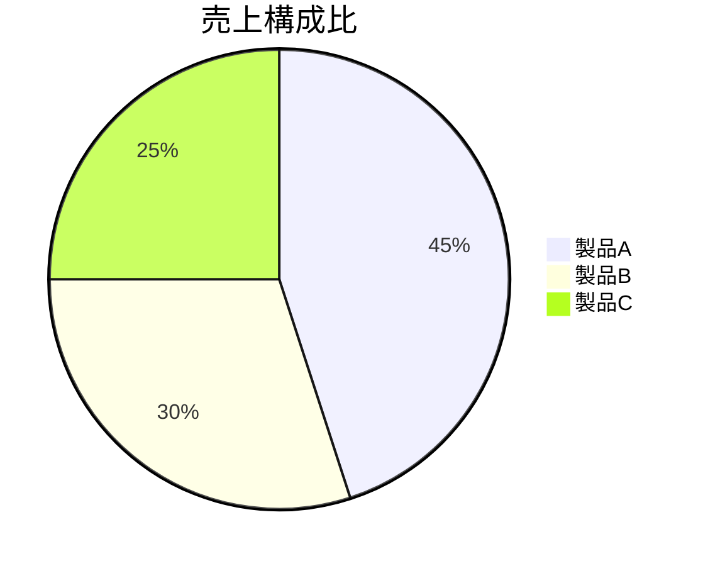

---

## Gitフロー

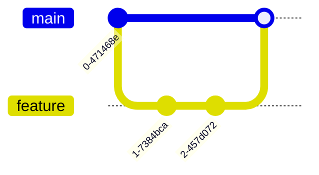

---

## 総合デモ（おすすめ）

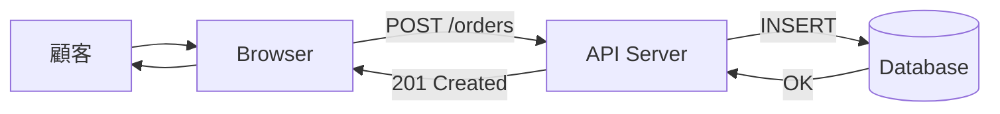

---
