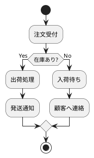
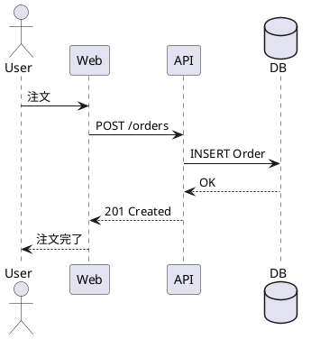
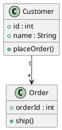
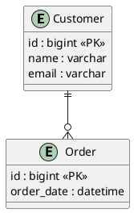
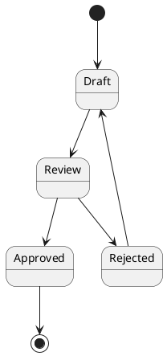
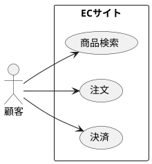
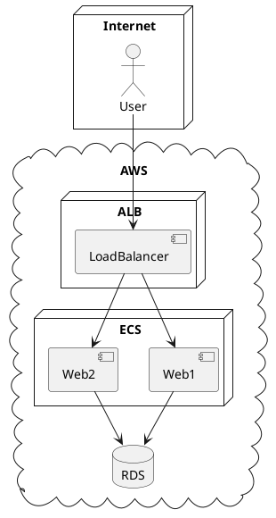
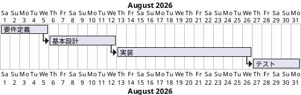
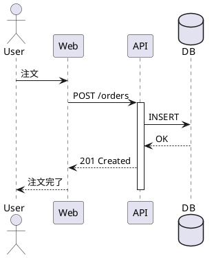

# PlantUML Demonstration

---

## アクティビティ図（業務フロー）

---

## シーケンス図

---

## クラス図

---

## ER図

---

## 状態遷移図

---

## ユースケース図

---

## コンポーネント図

---

## AWS風システム構成図

---

## Ganttチャート

---

## 総合デモ（おすすめ）

